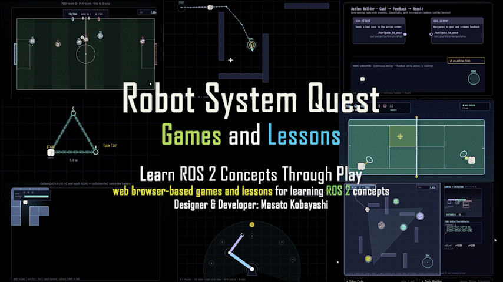

# Robot System Quest: Games and Lessons

Robot System Quest: Games and Lessons is a browser-based learning experience for exploring ROS 2, robotic systems, and Physical AI foundations by controlling robots and running small experiments.

It visualizes concepts such as publishers, subscribers, services, actions, feedforward and feedback control, LiDAR, image processing, TF, SLAM, localization, Nav2, behavior trees, and manipulation through games and interactive lessons. Four mini labs introduce imitation learning, reinforcement learning, vision-language-action policies, and learned world models. It does not connect to a real ROS 2 environment or physical robot.



- [YouTube](https://youtu.be/iXOOvXn6CYc)
- [Game and Lessons Site (English and Japanese)](https://mertcookimg.github.io/robot-system-quest/)
- [Guide Page (English and Japanese)](https://mertcookimg.github.io/robot-system-quest/guide/)

- **GAME** — 14 stages that introduce robotics concepts through delivery missions, racing, robot soccer, mapping, and more
- **LESSON** — 24 stages for experimenting with node wiring, block editing, parameter tuning, image processing, navigation, imitation learning, reinforcement learning, VLA, world models, and more
- **ROBOTICS LEARNING GUIDE** — Bilingual explanations of what to try and observe in each game and lesson
- **Keyboard / Gamepad / Touch** — Keyboard and gamepad support across all stages, plus controls designed for touch devices
- **Japanese / English** — Switch the interface language at any time
- **Light / Dark** — Starts in Dark unless a theme choice is saved. Choose either theme on Home, in the app, or in the Guide. The saved choice follows you between pages without restarting a stage.
- **Client-side only** — Runs without a backend

> This project is a simplified simulation for learning ROS 2 concepts. It does not communicate with physical ROS 2 nodes or sensors.

## Run locally

You will need a modern browser and Node.js 24.22.1 or later within the 24.x line.
Local development, CI, and deployment builds all use Node.js 24.x. Both GitHub
Actions workflows read the version range from `engines.node` in `package.json`
and select the latest matching release. Keep your local Node.js 24.x updated too;
24.22.1 includes the October 21, 2026 security fixes.

```bash
npm ci
npm run dev
```

The development server uses these URLs by default:

- Home / Game / Lesson: <http://localhost:5173/>
- Robotics Learning Guide: <http://localhost:5173/guide/>

The Guide includes an [all 14 Games showcase](https://youtu.be/bTiUXUTwiko) with English on-screen
text in dark mode, plus a Japanese/English video walkthrough of all 24 Lessons. Both start as
compact thumbnail cards, side by side on wide screens and stacked on smaller screens.
Open a video and its chapter list to watch a stage's segment, then
open that Game or Lesson directly to try it. Closing a video stops its playback.
Game and Lesson cards and detail pages also link to the corresponding YouTube timestamp.
Players load on request. The videos have background music without spoken narration.

`npm run dev` starts the development environment. To test the production build locally, run:

```bash
npm run build
npm run preview
```

The production files are written to `dist/`. Pushes to `main` are tested, built, and deployed
to GitHub Pages by the included workflow. The workflow derives the deployment subpath from the
repository name, so renamed forks do not need to edit `vite.config.ts`.

Analytics is disabled by default, including during local development and in forks. Repository
owners who want Google Analytics can define the Actions repository variable
`GA_MEASUREMENT_ID`; it is passed to production builds as `VITE_GA_ID`.

When enabled, analytics records aggregate stage starts, completions, resets, exits, play duration,
stars, Guide detail opens, Guide-to-stage clicks, and Guide section views. Events use only
predefined stage and section identifiers; user-entered text, simulated terminal commands, and
saved progress are not sent.

## npm scripts

| Command | Description |
|---|---|
| `npm run dev` | Regenerate Guide metadata and runtime stage listings, then start the Vite development server |
| `npm run build` | Regenerate both catalogs, type-check, and build both entry points in `dist/` |
| `npm run preview` | Serve the production build locally |
| `npm test` | Run model, control, terminal, and DOM interaction tests; check README stage tables and both generated catalogs |
| `npm run format` | Format code and documentation with Prettier |
| `npm run format:check` | Check for formatting differences |
| `npm run gen:stages` | Update the README stage lists from the stage manifests |
| `npm run check:stages` | Check that the README stage lists are up to date |
| `npm run gen:guide` | Generate bilingual Guide metadata and runtime stage listings from the stage manifests |
| `npm run check:guide` | Check that both generated catalogs match the current stages |

The Guide reads `src/guide/stages.generated.json`, which includes descriptions, diagrams and
ROS interface examples. The playable app uses the smaller `src/core/stages.generated.json`
for its stage lists: only IDs, modes, ordering, and bilingual names and lesson labels.
`src/core/stage_catalog.ts` connects those listings to dynamic imports, so the runtime loads
the selected stage's implementation when needed.

`npm run dev` and `npm run build` regenerate both catalogs automatically; after editing
stage metadata while the dev server is running, run `npm run gen:guide` again. `npm test`
checks that both catalogs are current. The production build keeps playable stages and model
weights out of the Guide's dependencies and the playable app's initial static dependencies.
Edit the stage manifests rather than the generated JSON.

## Controls

Controls depend on the stage. Open **Help** for common controls and **Stage guide** for the current stage's controls and completion conditions. **Learning guide** opens the separate guide with concepts and experiments.

| Action | Keyboard | Gamepad |
|---|---|---|
| Move / turn | `WASD` / arrow keys | Left stick / D-pad |
| Boost in supported driving stages | `Shift` / `X`, depending on the stage; Joint Teleop uses `Shift` for precision | `LB` / `RB` / `LT` / `RT`, depending on the stage |
| Release manual movement input | `Space` during ordinary driving | `A` during ordinary driving |
| Reset | `R` outside text entry | `Start`, except in block editors where it clears the entire program |
| Open Help | `?` / `/`; `Esc` closes it | `R3` toggles Help; `B` closes it |
| Select a stage | Click/tap GAME / LESSON, or focus with `Tab` and press `Enter` | `Select` / `Back` |
| Simulated ROS 2 commands | Terminal at the bottom of the screen | Press `L3` to open the command palette |
| Confirm / close | `Enter` / `Space` / `Esc` | `A` / `B` |
| Release terminal input focus | `Esc` | `B`; `L3` also closes the command palette |

Gamepad API button numbers and names may differ by browser, operating system, and controller.

Manual movement release does not stop an automatic program or pause the simulation. In other
stages, `Space` / gamepad `A` performs the indicated action, such as confirming, grabbing or
opening settings. Release the movement keys or stick to stay still.

In the block editor, click/tap blocks and values to edit, then use **RUN** or **STOP**.
Standard gamepad directions select, `A` adds/edits/confirms, and `B` leaves editing. `X` runs,
`Y` stops, and `LB` / `RB` reorder blocks. In Edge Detection and Object Detection, `Y` switches
DRIVE / TUNE instead. **Gamepad `Start` clears the entire program (CLEAR).**
`LT` / `RT` toggle the start-position and practice controls when those buttons are present.

On touch devices, use the displayed D-PAD / JOY or dedicated arm controls. The generic
BOOST / OK / ✕ / R buttons send `Shift` / `Space` / `Esc` / `R`, so their roles depend on the
stage. Tap puzzle ports, blocks and parameter controls directly to edit them.

Menus, help and completion dialogs pause the simulation. Terminal controls and the command
palette keep the simulation, timers and topic messages running while capturing player input.
While a terminal control has focus, keyboard/gamepad input is used by the terminal rather
than manual robot controls; an already running automatic program continues.
Leaving the window pauses the simulation and releases held inputs. Shared instructions appear
as readable, wrapping text below the scene at every screen size. On small screens, timing
also moves below the scene.

The Game / Lesson scene follows page scrolling at every screen size. It scales with the
window height to leave room for parameter controls; long scene instructions scroll inside
their own readout. Wide learning-lab layouts keep the scene beside their settings.

In the stage picker, use arrow keys or `Tab` / `Shift+Tab` to move focus and `Enter` / `Space`
to confirm the focused control. Clicking the other GAME / LESSON tab switches the open list;
clicking the selected tab closes it. The running stage changes only after choosing a card.
Restarting from the all-clear screen returns to Delivery and the GAME list.

After a collision that opens the failure screen, the stage restarts automatically after about
1.3 seconds. `Esc`, gamepad `B`, or the touch close control starts the next attempt immediately.
In the mini labs, dismissing the completion dialog keeps the completed results available for
review; restarting begins another experiment.

Object Detection shows classes, confidence, velocity, and simulated processing time as HTML
text, with numbered boxes in the camera image and expandable detection JSON. On small screens,
these results sit below the scene. Behavior Tree and TF use larger text and controls; Behavior
Tree labels each condition and action separately.

### Simulated ROS 2 terminal

All 24 lessons and 14 games expose their simulated nodes, topics and available services or
actions in the terminal. The guide, command selector and gamepad palette use the same stage
definitions. Player-dependent graphs follow the current one-player or two-player mode.
Use `ros2 topic list -t`, `ros2 node list`, `ros2 topic info <topic>` or
`ros2 topic echo <topic>` in the terminal, command selector, or gamepad palette.
The simulation keeps running while you inspect the terminal; keyboard and gamepad stage
controls stay neutral. Use `Esc` or gamepad `B` to release terminal input focus when needed.
`L3` toggles the gamepad command palette.

L21–L24 expose their actual lesson events through `std_msgs/msg/String` diagnostic topics:

| Lesson | Simulated node | Topics |
|---|---|---|
| L21 Imitation Learning Mini Lab | `/imitation_lab` | `/imitation/data`, `/imitation/training`, `/imitation/evaluation` |
| L22 Reinforcement Learning Mini Lab | `/rl_lab` | `/learning`, `/rl/evaluation` |
| L23 VLA Mini Lab | `/vla_policy` | `/vla/action` |
| L24 World Model Mini Lab | `/world_model_planner` | `/world_model/trial`, `/world_model/result` |

Operate the stage to generate events. `echo` shows a snapshot of the latest saved messages;
run it again to refresh. The monitor displays the latest 14 messages across topics; terminal
queries retain up to 30 messages per topic. Changing stages or restarting clears both histories.
These are compact browser logs, not complete serialized ROS messages or a
connection to ROS 2 processes or hardware. Service and action events use separate diagnostic
topics; service endpoints and action results are not presented as ordinary topics.
Parameter and lifecycle queries report only state explicitly modeled by the current stage.
The terminal does not train models or change stage settings: unsupported publishing, service
calls, action goals and parameter writes are reported as unavailable. The
[terminal contract tests](tests/stage_terminal_contracts.test.ts) check each stage's graph,
available commands, and published topics.

### Local two-player games

The following games support local competitive play with a shared keyboard or two gamepads:

- Racing
- Robo Soccer
- Tag Chase
- Sumo Battle
- Robo Tennis

Press `2` on the keyboard or gamepad `Y` to switch between one-player and two-player modes.
On a keyboard, Player 1 uses `WASD` and Player 2 uses the arrow keys. Where the game provides an
action, Player 1 uses `E` and Player 2 uses `Enter`. In games with boost, Player 1 uses left
`Shift` and Player 2 uses right `Shift`. Tennis uses those Shift keys to swing instead.
Consult Stage guide for game-specific actions.

## Technology

- **Vite** — Development server and multi-page production build
- **TypeScript** — Strict mode with `noEmit`
- **Canvas 2D** — Rendering and animation for games and lessons
- **Web Audio API** — Sound effects generated at runtime
- **Gamepad API** — Single-player controls and local two-player games
- **localStorage** — Persists language, progress, stars, best times, and other settings
- **Node.js Test Runner + tsx** — Automated tests for models, control logic, and simulated ROS contracts
- **happy-dom + Vite SSR** — DOM regression tests for input routing, menus, lesson state, and Guide behavior
- **Prettier** — Code and documentation formatting

## Project structure

```text
index.html                    Home / Game / Lesson
guide/index.html              Robotics Learning Guide
public/                       Static assets
src/
  main.ts                     Game / Lesson entry point
  types.ts                    Shared types for stages, GameContext, and ROS 2 data
  core/                       Navigation, input, progress, modals, and stage registration
    stage_catalog.ts          Registers listings and loads the selected stage on demand
    stages.generated.json     Lightweight bilingual stage listings for runtime menus
    stage_collect.ts          Imports all stages for catalog generation and tests
    stage_def.ts              defineStage(), stage loaders, and the stage registry
  guide/                      Guide UI, bilingual content, and card animations
    stages.ts                 Language-aware access to Guide metadata
    stages.generated.json     Generated descriptions, diagrams, and ROS interface examples
  i18n/                       Japanese and English dictionaries for games and lessons
  lib/                        Shared rendering, control, input, and editor modules
  stages/
    game/                     Game stages
    lesson/                   Lesson stages
  styles/                     Modular CSS for games and lessons
tests/
  control_math.test.ts         Coordinate and angle conversions
  navigation_stage.test.ts     Goal position/orientation and completion timing
  stage_menu.test.ts           Stage selection, focus, and mode transitions
  crash_terminal.test.ts       Failure recovery and returning from the terminal
  stage_readability.test.ts    HTML results, labels, reset, and cleanup
  guide_ui.test.ts             Guide content, navigation, and metadata isolation
scripts/
  gen-stage-list.mjs           Generates the README stage lists
  gen-guide-catalog.mjs        Generates Guide metadata and runtime stage listings
docs/
  ADD_A_STAGE.md              Instructions for adding a new stage
```

Vite builds `index.html` and `guide/index.html` as separate entry points. The Game / Lesson runtime
uses a lazy `import.meta.glob` to load the selected stage. Catalog generation and all-stage tests
use `stage_collect.ts` to evaluate every manifest. The Guide reads generated metadata and shares
presentation helpers. The build rejects executable stages or VLA/world-model weights anywhere
in the Guide's dependency graph, including dynamic imports, and in the playable app's initial
static dependency graph.

## Verification

After changing stage definitions, refresh the generated documentation before running checks:

```bash
npm run gen:stages
npm run gen:guide
npm test
npm run build
```

Tests cover model behavior, simulated ROS messages, goal completion, failure recovery, input
ownership, menu focus, live terminal inspection, and DOM state during reset, language changes,
and stage disposal. Catalog checks verify both generated catalogs, and loading tests exercise
on-demand stage initialization. These tests do not validate rendered canvas pixels or physical
controller drivers.

For UI changes, also check the production preview in a browser at phone, tablet, and desktop
widths (for example 375, 768, and 1280 px). Exercise stage selection, help, live terminal inspection,
completion, retry, and switching between Game and Lesson with keyboard, touch, and available
gamepads. Check both Japanese and English.

## Stages

### GAME

<!-- STAGES:GAME -->
| # | ID | Concept |
|----|----|----|
| G1 | `delivery` | Publisher — drive the robot via a topic |
| G2 | `follower` | Subscriber — act on data from other nodes |
| G3 | `lidar_explorer` | Sensor Subscribe — read the world via LiDAR |
| G4 | `patrol` | Service & Lifecycle — shut down a runaway node |
| G5 | `racing` | Action — autonomous path-following navigation |
| G6 | `robo_soccer` | Robo Soccer — multi-robot teleop |
| G7 | `treasure_map` | Mapping (SLAM lite) — building /map from /scan |
| G8 | `tag_chase` | Multi-robot pursuit — read peer poses from a shared topic |
| G9 | `sumo_battle` | Odometry — knowing where you are via /robot/odom |
| G10 | `battery_rush` | BatteryState — monitor charge and drive back to the dock |
| G11 | `robo_kitchen` | Robo Kitchen — manipulation sequences |
| G12 | `swarm_rescue` | Swarm Helpers — multi-robot teamwork |
| G13 | `robo_baseball` | Vision Tracking — predict where the pitch will cross |
| G14 | `robo_tennis` | 3D Ball Tracking — position, height and bounce |
<!-- STAGES:GAME:END -->

### LESSON

<!-- STAGES:LESSON -->
| # | ID | Concept |
|----|----|----|
| L1 | `pubsub_builder` | Pub/Sub — link nodes via topics |
| L2 | `service_builder` | Service — request → response between Client and Server |
| L3 | `action_builder` | Action — long-running tasks + progress + cancellation |
| L4 | `param_tuner` | Parameters — live tuning with ros2 param set |
| L5 | `feedforward_controller` | Feedforward — draw an equilateral triangle by time |
| L6 | `feedforward_mission` | Feed-forward — publish a planned sequence of cmd_vel |
| L7 | `feedback_controller` | Feedback — draw an equilateral triangle with Odometry |
| L8 | `feedback_mission` | Feedback Mission — dodge walls and reach GOAL via odom feedback |
| L9 | `lidar_avoidance` | Reactive Control — drive forward when LiDAR shows the front is clear |
| L10 | `tf_puzzle` | TF — describe a sensor mount with a transform |
| L11 | `mapping_mission` | Teleop SLAM — drive and fill /map yourself |
| L12 | `localization_mission` | AMCL — estimate your pose inside a known map |
| L13 | `navigation` | Nav2 — click to send a goal, A* plans the path |
| L14 | `image_processing` | Image Processing |
| L15 | `edge_detection` | Camera + Teleop — observe Image Processing while driving |
| L16 | `object_detection` | Simulated Object Detection |
| L17 | `behavior_tree` | Behavior Tree — Nav2-style decision making |
| L18 | `joint_teleop` | JointState — jog each joint directly and watch the tip (forward kinematics) |
| L19 | `ik_reach` | Inverse Kinematics — command the tip pose, solve back for joint angles |
| L20 | `pick_place` | Pick & Place — grasp and transport |
| L21 | `imitation_learning` | Imitation Learning Mini Lab |
| L22 | `reinforcement_learning` | Reinforcement Learning Mini Lab |
| L23 | `vla_lab` | VLA Mini Lab |
| L24 | `world_model` | World Model Mini Lab |
<!-- STAGES:LESSON:END -->

These tables are generated from the `defineStage()` manifests. Do not edit content between the markers directly. Run `npm run gen:stages` after changing a stage.

The concept labels refer to the wider ROS 2 topic; each lesson implements a limited exercise.
Action Builder covers goal acceptance, feedback, and successful completion, with no cancel
operation. Parameter Tuner changes settings through on-screen controls, not terminal writes.
Behavior Tree explores the priority of condition/action rules, rather than editing asynchronous
Running states or Nav2 Recovery subtrees.

Navigation requires five goals that need a change of position or orientation. A goal is reached
only within the position and heading tolerances; resending an already satisfied goal does not
increase the count. Time covers the full five-goal attempt. Changing goal heading affects the
final in-place turn, while A* plans the route from positions.


## Add a new stage

See [`docs/ADD_A_STAGE.md`](docs/ADD_A_STAGE.md) for detailed instructions.

The basic workflow is:

1. Create `src/stages/game/<id>.ts` or `src/stages/lesson/<id>.ts`.
2. Implement a factory function that returns a `Stage`.
3. Default-export `defineStage({ mode, order, ... })`.
4. Extend `src/guide/` if the stage needs a custom explanation or animation.
5. Run `npm run gen:stages` and `npm run gen:guide` to update the README stage tables and both catalogs.
6. Verify formatting, tests, the production build, and browser controls.

## Contributing

Issues and pull requests are welcome. See [`CONTRIBUTING.md`](CONTRIBUTING.md) for the development
workflow, project-specific requirements, verification steps, and pull request guidelines.

## Related learning resources

- [ROS 2 lectures and hands-on materials](https://mertcookimg.github.io/ros2_lecture/)
- [ROS 2 packages used in the lectures](https://github.com/mertcookimg/kachaka_ros2_lecture/)
- [Masato Kobayashi](https://mertcookimg.github.io/)
